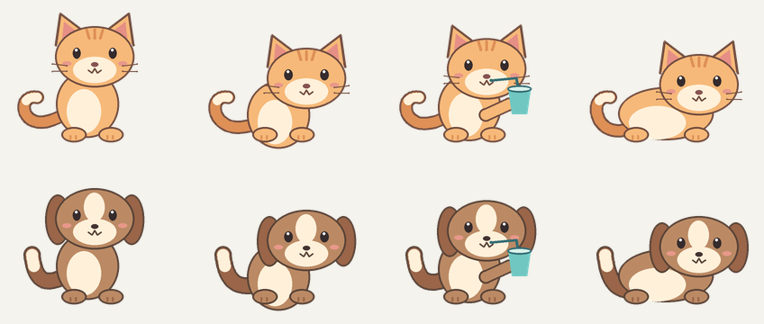

# 坐直小伙伴 Posture Companion


一个本地优先的 Windows 坐姿与久坐提醒工具。它通过固定摄像头观察身体高度、头部大小和肩背变化，提醒你坐直、按时活动，并用一只透明悬浮的猫猫或狗狗同步你的姿势。



## 主要功能

- 多信号坐直评分：头部高度下降、头部靠近、肩膀下沉、躯干缩短、颈肩压缩和深度前移；
- 个人校准：每个摄像头保存独立的正确坐姿基线；
- 透明桌面宠物：猫猫/狗狗同步直坐、前倾、塌坐和离座；
- 宠物动作：喝水提醒时喝水，肩颈操或远眺提醒时伸展；
- 主窗口和宠物旁均可暂停或继续摄像头，久坐计时可独立运行；
- 连续未坐直弹窗、Windows 通知和可调提醒阈值；
- 自动离座识别、久坐计时和每日活动清单；
- 每日待办与最近 7 天坐直率统计；
- 系统托盘、多摄像头选择和 Windows 登录后自动启动。

摄像头画面只在本机内存中处理，不保存、不上传。详细说明见 [隐私说明](PRIVACY.md)。本项目用于日常习惯提醒，不是医疗诊断工具。

## 下载 Windows 版本

请从仓库的 **Releases** 页面下载最新的 `PostureCompanion-*-Windows-x64.zip`，解压整个文件夹后双击 `PostureCompanion.exe`。不要只移动 EXE，程序需要旁边的 `_internal` 文件夹。

首次运行：

1. 让头部和双肩完整进入摄像头画面；
2. 固定摄像头，自然坐直；
3. 在“坐直监测”点击“校准坐直姿势”，保持约 3 秒；
4. 移动摄像头、椅子或坐姿距离后重新校准。

Windows 可能对尚未签名的新程序显示“未知发布者”。请只从本仓库 Releases 下载，并核对发布页提供的 SHA-256。

## 从源码运行

要求：Windows 10/11、Python 3.10–3.12、可用摄像头。

```powershell
Set-ExecutionPolicy -Scope Process Bypass
.\setup.ps1
.\start.ps1
```

`setup.ps1` 会创建 `.venv`、安装依赖并从 Google MediaPipe 下载 Pose Landmarker Lite 模型。模型下载完成后，日常姿势检测可离线运行。

## 测试

```powershell
$env:PYTHONPATH = "$PWD\src"
.\.venv\Scripts\python.exe -m pip install pytest
.\.venv\Scripts\python.exe -m pytest tests -q -p no:cacheprovider
```

## 构建 Windows 程序

```powershell
.\build.ps1
```

构建结果：`dist\PostureCompanion\PostureCompanion.exe`。

## 坐直评分

程序先采集自然坐直时的个人基线，再对实时特征做平滑并生成 0–100 的“未坐直分数”。默认 40 分开始判定为没有坐直；快速通知和长期弹窗使用独立的时间阈值。算法与局限详见 [docs/algorithm.md](docs/algorithm.md)。

## 项目结构

```text
posture-companion/
├── src/posture_companion/   # 应用、姿态评分、宠物、存储和系统集成
├── tests/                   # 单元测试
├── scripts/                 # 模型下载与图标生成
├── hooks/                   # PyInstaller 的 Tkinter hooks
├── docs/                    # 算法与预览资料
├── setup.ps1                # 创建开发环境
├── start.ps1                # 从源码启动
├── build.ps1                # 生成 Windows 目录版程序
└── PostureCompanion.spec    # PyInstaller 构建配置
```

## 参与贡献

欢迎提交问题和改进建议。开始前请阅读 [CONTRIBUTING.md](CONTRIBUTING.md)。安全问题请按 [SECURITY.md](SECURITY.md) 的方式报告。

## 许可证与第三方组件

本项目采用 [MIT License](LICENSE)。第三方依赖及其许可证见 [THIRD_PARTY.md](THIRD_PARTY.md)。
